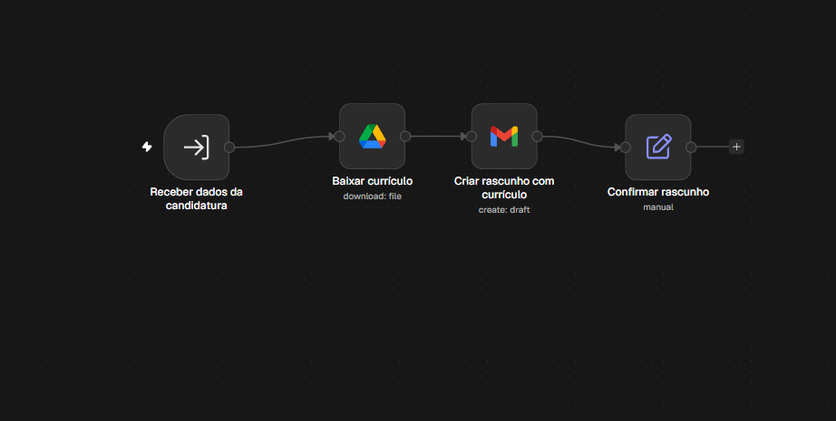

   ## *Automação de Candidaturas com n8n*

Workflow desenvolvido com **n8n** para automatizar a criação de rascunhos de e-mails de candidatura a vagas de emprego, com anexo automático de currículo em PDF.

O projeto integra Google Drive e Gmail, permitindo receber informações de uma candidatura, localizar o currículo armazenado na nuvem e preparar um e-mail automaticamente, sem realizar o envio.

  ## Objetivo do projeto

Simplificar o processo de candidatura a vagas de emprego por meio da automação de tarefas repetitivas.

A solução permite:
- Receber dados da candidatura de forma dinâmica.
- Baixar automaticamente o currículo em PDF pelo Google Drive.
- Criar um rascunho de e-mail no Gmail.
- Anexar o currículo automaticamente.
- Retornar uma confirmação da criação do rascunho.

## Tecnologias utilizadas

- **n8n:** desenvolvimento e execução do workflow.
- **Google Drive API:** armazenamento e download do currículo.
- **Gmail API:** criação dos rascunhos de e-mail.
- **JSON:** estruturação e exportação do workflow.

## Como funciona o projeto

O workflow é composto por quatro etapas principais:

### 1. Receber dados da candidatura

O processo começa com o nó `Receber dados da candidatura` (Execute Workflow Trigger).

Ele recebe três informações:

| Campo | Descrição |
|---|---|
| `destinatario` | Endereço de e-mail da empresa ou recrutador. |
| `assunto` | Assunto do e-mail de candidatura. |
| `mensagem` | Conteúdo do e-mail. |

Esses dados são utilizados dinamicamente nas próximas etapas.

### 2. Baixar currículo

O nó `Baixar currículo` utiliza a integração com o Google Drive para localizar e baixar o arquivo PDF.

O documento é armazenado na propriedade binária `data`, permitindo sua utilização como anexo na próxima etapa.

**Configuração necessária:**
- Conectar uma conta Google Drive.
- Informar o ID do arquivo PDF do currículo.
- Verificar se a conta possui permissão para acessar o documento.

### 3. Criar rascunho com currículo

O nó `Criar rascunho com currículo` utiliza a integração com o Gmail.

Nessa etapa, o workflow:
- Recupera o destinatário recebido inicialmente.
- Define o assunto do e-mail.
- Insere a mensagem em formato HTML.
- Anexa o currículo baixado anteriormente.
- Cria um rascunho na conta Gmail conectada.

**Importante:** o projeto cria somente um rascunho. O envio do e-mail depende da revisão e confirmação manual do usuário.

### 4. Confirmar rascunho

A última etapa utiliza o nó `Confirmar rascunho` (Set).

Ele organiza as informações retornadas pela execução:

- Status da operação.
- Identificador do rascunho criado.
- Destinatário.
- Assunto do e-mail.

Isso permite retornar uma confirmação estruturada ao workflow que iniciou a execução.

##  Fluxo de execução

```text
Receber dados da candidatura
            |
            v
      Baixar currículo
       (Google Drive)
            |
            v
 Criar rascunho com currículo
          (Gmail)
            |
            v
     Confirmar rascunho
            |
            v
       Retornar dados
```

##  Como instalar e utilizar

### 1. Importar o workflow

1. Baixe o arquivo JSON disponível neste repositório.
2. Acesse sua instância do n8n.
3. Abra a opção de importação de workflow.
4. Selecione o arquivo JSON.

### 2. Configurar as credenciais

Após importar o workflow, configure suas próprias credenciais:

- Google Drive OAuth2.
- Gmail OAuth2.

As credenciais não estão incluídas no arquivo disponibilizado neste repositório por questões de segurança.

### 3. Configurar o currículo

No nó `Baixar currículo`:

1. Abra as configurações do Google Drive.
2. Substitua o valor de exemplo `SEU_ID_AQUI` pelo ID do seu próprio currículo.
3. Verifique as permissões de acesso ao arquivo.

### 4. Executar a automação

O workflow utiliza o nó Execute Workflow Trigger, portanto foi estruturado para ser chamado por outro workflow no n8n.

O workflow principal deve fornecer os seguintes campos:

- `destinatario`
- `assunto`
- `mensagem`

Após a execução, o sistema criará um rascunho no Gmail com o currículo anexado.

##  Segurança

Este repositório disponibiliza apenas a estrutura do workflow.

Por segurança:
- Credenciais pessoais não são incluídas.
- Tokens e senhas não são compartilhados.
- IDs pessoais de arquivos do Google Drive foram substituídos por valores de exemplo.
- Cada usuário deve configurar suas próprias integrações.

Nunca compartilhe credenciais ou informações privadas em repositórios públicos.

##  Aprendizados e conhecimentos aplicados

Durante o desenvolvimento deste projeto, foram trabalhados conceitos importantes de automação e integração de sistemas:

- Construção de workflows no n8n.
- Integração entre serviços do Google.
- Manipulação de dados em JSON.
- Utilização de expressões dinâmicas.
- Transferência e manipulação de arquivos binários.
- Automação de processos administrativos.
- Integração entre diferentes ferramentas e APIs.

##  Melhorias futuras

Algumas funcionalidades que podem ser implementadas em versões futuras:

- Personalização automática de mensagens utilizando Inteligência Artificial.
- Seleção de diferentes modelos de currículo.
- Tratamento de erros e validação dos dados recebidos.
- Registro do histórico de candidaturas.
- Integração com planilhas para acompanhamento das vagas.

##  Autor

**João Carlos**

Estudante de Engenharia de Software, interessado em desenvolvimento de software, automação de processos e integração de tecnologias.

Sempre buscando aprender, desenvolver projetos práticos e aprimorar conhecimentos em tecnologia.

---

⭐ Se este projeto foi útil, fique à vontade para explorar o workflow e adaptá-lo às suas necessidades.


## 📸 Visualização do Workflow


